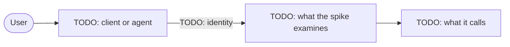

# Azure Functions on AKS: three ways to trigger on a blob upload

**Question:** Which way of triggering Azure Functions on AKS after a blob upload (the polling Blob trigger, Event Grid to a Storage queue, or Event Grid to Service Bus) works best with private networking, identity-only access and KEDA scaling, and at what latency, cost and operational effort?

**Time box:** 3 phases, stop and report after each · **Status:** in progress

## The setup

TODO: what runs where, in a few sentences, and with which identities; then the diagram of the components (a
`flowchart`, one arrow per call, labelled with the identity it uses).



## Key findings

Phases 1 (public endpoints, Entra only, 2026-11-18) and 2 (private endpoints, private API server and registry, 2026-11-19). Cost comes with phase 3.

| | Polling Blob trigger | Event Grid → Storage queue | Event Grid → Service Bus |
|---|---|---|---|
| Latency, 20 concurrent blobs, median (p95), phase 1 (phase 2: no measurable difference) | 5.4 s (5.9) | 12.7 s (13.6) with the default polling backoff; 1.5–2.7 s with `maxPollingInterval` 2 s | 1.6 s (1.7) |
| Identity only (Workload Identity, no keys) | yes | yes | yes |
| Private endpoints, destinations' public access off | yes | yes | yes |
| Scaling | fixed replicas (no KEDA scaler for new blobs) | KEDA, to zero and back (first blob in 23 s); bounded by node capacity in the test | KEDA, to zero and back (23 s); one replica kept up with 500 messages |
| Exactly one processing per blob (duplicates, killed pod, rolling restart, outage) | yes | yes | yes |
| Malformed events | — | completed and logged; undecodable ones poisoned | dead-lettered with a reason |
| Watch out for | WebJobs blob extension 5.3.10 or later | lower `maxPollingInterval` for latency | AMQP egress (TCP 5671) |

The answers to every question, with the evidence: **[docs/FINDINGS.md](docs/FINDINGS.md)**.

## Documents

| Document | Content |
|---|---|
| [Questions](docs/QUESTIONS.md) | What the spike must answer, and the status of each question |
| [Experiments](docs/experiments/README.md) | One file per experiment, numbered |
| [Findings](docs/FINDINGS.md) | The answers, with links to the evidence |
| [Retest plan](docs/RETEST-PLAN.md) | What to run again when a product changes |
| [Demo runbook](docs/DEMO-RUNBOOK.md) | How to show the results |

## Environment

The infrastructure is one Terraform root (`infra/`), one file per part, built from the modules in `infra/modules/`. azd runs the steps of `infra/hooks/<event>/` around it (state backend before, configuration after, a clean teardown).

```bash
az login && azd auth login
azd env new aksfunc-dev --location francecentral
azd env set RESOURCE_TAGS "key=value,key=value"   # tags your tenant's policies require, if any
azd hooks run preprovision                        # remote state backend: once before the first preview
azd provision --preview                           # read the plan
azd up                                            # provision, then deploy the services
```

Phase 2 (`azd env set PRIVATE_NETWORKING true`) makes the API server and the registry private: open a working session with `infra/scripts/bastion-up.sh 4`, then run `kubectl`, the scenarios and `azd deploy` on the jumpbox (`infra/scripts/bastion-ssh.sh`). There, the images are built with Docker: install it, and set `remoteBuild: false` in the jumpbox's copy of `azure.yaml` (the registry refuses azd's remote build once its public access is off, [05](docs/experiments/05-making-phase-2-run.md)). The reaper ends the session when its time is up ([docs/DESIGN.md](docs/DESIGN.md#private-access)).

Later changes: `azd provision --preview`, read the plan, then `azd provision`.

Tear it down when the spike ends: `azd down --purge`.

## Build and test locally

```bash
dotnet test BlobTriggers.slnx                     # the apps' unit tests
terraform -chdir=infra fmt -check -recursive      # then terraform test in each infra/modules/<module>
```

The design every part follows: [docs/DESIGN.md](docs/DESIGN.md).
